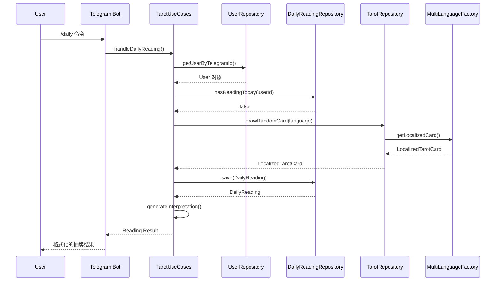
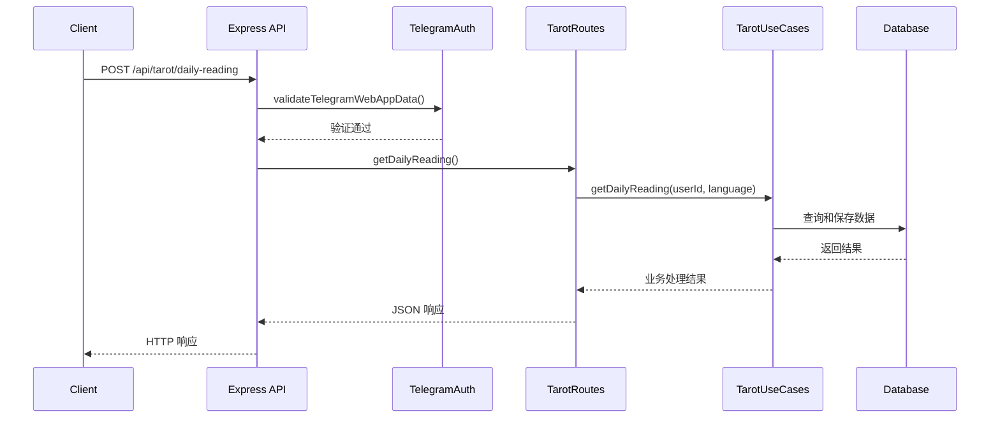

# Tarot Stars Server 功能设计模块文档

## 📋 文档概述

本文档详细描述了 Tarot Stars Server 的功能设计模块，包括核心业务功能、技术实现和模块间的交互关系。

---

## 🏗️ 整体架构设计

### DDD 分层架构
```
┌─────────────────────────────────────────────────────────────┐
│                    接口层 (Interfaces)                      │
├─────────────────────┬───────────────────────────────────────┤
│   Telegram Bot      │           REST API                    │
│   - Commands        │           - Routes                    │
│   - Menu System     │           - Middleware                │
│   - I18n Messages   │           - Authentication            │
└─────────────────────┴───────────────────────────────────────┘
┌─────────────────────────────────────────────────────────────┐
│                    应用层 (Application)                     │
├─────────────────────────────────────────────────────────────┤
│   - TarotUseCases (塔罗牌业务逻辑)                          │
│   - UserUseCases (用户管理业务逻辑)                         │
└─────────────────────────────────────────────────────────────┘
┌─────────────────────────────────────────────────────────────┐
│                     领域层 (Domain)                        │
├─────────────────────────────────────────────────────────────┤
│   实体 (Entities)    │    仓储接口 (Repositories)           │
│   - User            │    - IUserRepository                 │
│   - DailyReading    │    - IDailyReadingRepository         │
│   - TarotCard       │    - INewTarotRepository             │
│   - CardCategory    │                                      │
│   - CardSuit        │    服务接口 (Services)               │
│   - TarotDeck       │    - ITarotService                   │
│                     │    - IUserService                    │
└─────────────────────┴──────────────────────────────────────┘
┌─────────────────────────────────────────────────────────────┐
│                  基础设施层 (Infrastructure)                │
├─────────────────────────────────────────────────────────────┤
│   数据库 (Database)  │    仓储实现 (Repositories)           │
│   - MongoConnection │    - MongoUserRepository             │
│                     │    - MongoDailyReadingRepository     │
│   服务实现 (Services)│    - TarotRepository                 │
│   - MultiLanguage   │    - MultiLanguageTarotRepository    │
│   - DataMigration   │                                      │
└─────────────────────┴──────────────────────────────────────┘
```

---

## 🎯 核心功能模块

### 1. 用户管理模块 (User Management)

#### 1.1 功能概述
- **用户注册与认证**: 基于 Telegram 用户信息自动创建账户
- **用户信息管理**: 存储和更新用户基本信息
- **多语言偏好**: 支持用户语言偏好设置
- **使用统计**: 记录用户抽牌次数和活跃度

#### 1.2 核心实体
```typescript
interface User {
  _id?: ObjectId;           // MongoDB 主键
  telegramId: number;       // Telegram 用户 ID（唯一）
  username?: string;        // Telegram 用户名
  firstName?: string;       // 名字
  lastName?: string;        // 姓氏
  languageCode?: string;    // 语言偏好
  lastReadingDate?: number; // 最后抽牌时间
  totalReadings: number;    // 总抽牌次数
  createdAt: number;        // 创建时间
  updatedAt: number;        // 更新时间
}
```

#### 1.3 主要功能
- **自动用户创建**: 用户首次使用时自动创建账户
- **信息同步**: 定期同步 Telegram 用户信息变更
- **语言检测**: 自动检测用户 Telegram 语言设置
- **统计追踪**: 记录用户使用行为和偏好

#### 1.4 技术实现
- **仓储模式**: `MongoUserRepository` 实现数据持久化
- **业务逻辑**: `UserUseCases` 处理用户相关业务
- **索引优化**: `telegramId` 唯一索引确保数据一致性

---

### 2. 塔罗牌管理模块 (Tarot Card Management)

#### 2.1 功能概述
- **多语言塔罗牌库**: 支持中英日韩四种语言
- **卡牌分类管理**: 大阿卡纳、小阿卡纳分类
- **花色系统**: 权杖、圣杯、宝剑、金币四大花色
- **动态本地化**: 根据用户语言动态返回对应内容

#### 2.2 数据结构设计

##### 卡牌实体
```typescript
interface TarotCardNew {
  _id?: string;
  cardId: string;              // 唯一标识符 (如 'rw-major-00')
  deckId: string;              // 牌组ID (如 'rider-waite')
  categoryId: string;          // 分类ID ('major_arcana', 'minor_arcana')
  suitId?: string;             // 花色ID (大阿卡纳为空)
  number: number;              // 卡牌编号
  rank?: string;               // 等级 (ace, two, three, ..., king)
  
  images: {
    original: string;          // 原图
    thumbnail: string;         // 缩略图
    watermark?: string;        // 水印版本
  };
  
  content: {                   // 多语言内容
    [K in SupportedLanguage]: CardMultiLanguageContent;
  };
  
  metadata: {                  // 元数据
    symbolism?: string[];      // 象征意义
    astrology?: {              // 占星学关联
      planet?: string;
      sign?: string;
      element?: string;
    };
    numerology?: {             // 数字学
      number: number;
      meaning?: string;
    };
  };
}
```

##### 多语言内容
```typescript
interface CardMultiLanguageContent {
  name: string;                // 卡牌名称
  description: string;         // 描述
  keywords: {
    upright: string[];         // 正位关键词
    reversed: string[];        // 逆位关键词
  };
  meaning: {
    upright: string;           // 正位含义
    reversed: string;          // 逆位含义
  };
}
```

#### 2.3 核心功能
- **随机抽牌**: 支持指定牌组和语言的随机抽取
- **卡牌查询**: 按ID、分类、花色等条件查询
- **本地化服务**: 多语言工厂模式动态生成本地化内容
- **数据迁移**: 支持从旧格式到新多语言格式的数据迁移

#### 2.4 技术实现
- **工厂模式**: `MultiLanguageFactoryService` 处理多语言转换
- **仓储实现**: `TarotRepository` 和 `MultiLanguageTarotRepository`
- **数据迁移**: `NewTarotDataMigrationService` 处理数据结构升级

---

### 3. 每日占卜模块 (Daily Reading)

#### 3.1 功能概述
- **每日一牌**: 每个用户每天只能抽取一张塔罗牌
- **正逆位随机**: 50% 概率决定卡牌正逆位
- **个性化解读**: 根据卡牌和正逆位生成解读内容
- **历史记录**: 保存用户所有抽牌历史

#### 3.2 核心实体
```typescript
interface DailyReading {
  _id?: ObjectId;              // MongoDB 主键
  userId: ObjectId;            // 用户ID
  cardId: string;              // 卡牌ID
  isReversed: boolean;         // 是否逆位
  date: number;                // 抽牌日期（毫秒时间戳）
  createdAt: number;           // 创建时间
}
```

#### 3.3 业务规则
- **唯一性约束**: 每个用户每天只能有一条抽牌记录
- **时区处理**: 基于用户本地时间计算"今日"
- **动态解读**: 不存储解读内容，而是动态生成以支持多语言

#### 3.4 核心算法

##### 每日抽牌流程
```typescript
async getDailyReading(userId: string, language: SupportedLanguage) {
  // 1. 检查今日是否已抽牌
  const hasReading = await this.hasReadingToday(userId);
  if (hasReading) {
    return await this.getTodayReading(userId, language);
  }
  
  // 2. 随机抽取新卡牌
  const newCard = await this.drawRandomCard(language);
  const isReversed = Math.random() < 0.5;
  
  // 3. 保存抽牌记录
  const reading = await this.saveReading({
    userId,
    cardId: newCard.cardId,
    isReversed,
    date: Date.now()
  });
  
  // 4. 生成动态解读
  const interpretation = this.generateInterpretation(
    newCard, isReversed, language
  );
  
  return { ...reading, card: newCard, interpretation };
}
```

#### 3.5 技术实现
- **时间处理**: 基于毫秒时间戳的精确时间管理
- **索引优化**: `userId + date` 复合索引确保查询性能
- **动态内容**: 解读内容不存储，实时生成支持多语言

---

### 4. Telegram Bot 模块

#### 4.1 功能概述
- **命令处理**: 支持 `/start`, `/daily`, `/history`, `/app`, `/help` 命令
- **交互式菜单**: 基于 InlineKeyboard 的丰富交互体验
- **多语言支持**: 根据用户语言显示对应界面
- **Mini App 集成**: 无缝跳转到 Web 应用

#### 4.2 命令系统

##### 核心命令
- **`/start`**: 用户注册和欢迎界面
- **`/daily`**: 获取每日塔罗牌
- **`/history`**: 查看历史抽牌记录
- **`/app`**: 打开 Mini App
- **`/help`**: 显示帮助信息

##### 命令处理流程
```typescript
class TarotCommands {
  async handleDailyReading(ctx: TarotBotContext) {
    // 1. 验证用户身份
    if (!ctx.user) {
      await ctx.reply(messages.pleaseRegister);
      return;
    }
    
    // 2. 检查今日抽牌状态
    const hasReading = await this.tarotUseCases.hasReadingToday(ctx.user._id);
    if (hasReading) {
      await ctx.reply(messages.alreadyDrawnToday);
      return;
    }
    
    // 3. 执行抽牌逻辑
    const reading = await this.tarotUseCases.getDailyReading(
      ctx.user._id, 
      userLanguage
    );
    
    // 4. 格式化并发送结果
    const message = this.formatReadingMessage(reading, userLanguage);
    await ctx.reply(message, { reply_markup: keyboard });
  }
}
```

#### 4.3 多语言系统

##### 语言支持
- **中文 (zh)**: 默认语言
- **英文 (en)**: 国际化支持
- **日文 (ja)**: 亚洲市场
- **韩文 (ko)**: 亚洲市场

##### 消息本地化
```typescript
interface BotMessages {
  welcome: {
    title: string;
    description: string;
    instructions: {
      daily: string;
      app: string;
      history: string;
      help: string;
    };
  };
  buttons: {
    dailyReading: string;
    openApp: string;
    viewHistory: string;
  };
  messages: {
    alreadyDrawnToday: string;
    drawingCard: string;
    noHistory: string;
  };
}
```

#### 4.4 技术实现
- **grammY 框架**: 现代化的 Telegram Bot 开发框架
- **会话管理**: 支持用户状态和对话流
- **中间件系统**: 用户认证、语言检测等中间件
- **错误处理**: 完善的异常处理和用户友好提示

---

### 5. REST API 模块

#### 5.1 功能概述
- **RESTful 设计**: 标准的 REST API 接口
- **Telegram 认证**: 基于 Telegram WebApp 的安全认证
- **多版本支持**: 支持 API 版本管理
- **CORS 配置**: 支持跨域访问

#### 5.2 API 端点设计

##### 用户相关
```
POST   /api/tarot/user                    # 创建或更新用户
GET    /api/tarot/user/:telegramId        # 获取用户信息
PUT    /api/tarot/user/:telegramId/language # 更新用户语言
```

##### 每日占卜
```
POST   /api/tarot/daily-reading           # 获取每日塔罗牌
GET    /api/tarot/has-reading-today/:userId # 检查今日抽牌状态
```

##### 历史记录
```
GET    /api/tarot/history/:userId         # 获取用户历史记录
```

##### 卡牌相关
```
GET    /api/tarot/cards                   # 获取所有卡牌
GET    /api/tarot/cards/:cardId           # 获取指定卡牌
GET    /api/tarot/cards/category/:categoryId # 按分类获取卡牌
GET    /api/tarot/cards/suit/:suitId      # 按花色获取卡牌
GET    /api/tarot/random-card             # 随机抽牌
```

##### 元数据
```
GET    /api/tarot/categories              # 获取卡牌分类
GET    /api/tarot/suits                   # 获取花色信息
GET    /api/tarot/decks                   # 获取牌组信息
GET    /api/tarot/languages               # 获取支持的语言
```

#### 5.3 认证与安全

##### Telegram WebApp 认证
```typescript
function validateTelegramWebAppData(initData: string, botToken: string): boolean {
  // 1. 解析参数
  const urlParams = new URLSearchParams(initData);
  const hash = urlParams.get('hash');
  
  // 2. 移除 hash 并排序
  urlParams.delete('hash');
  const sortedParams = Array.from(urlParams.entries())
    .sort(([a], [b]) => a.localeCompare(b))
    .map(([key, value]) => `${key}=${value}`)
    .join('\n');
  
  // 3. 计算期望的 hash
  const secretKey = crypto.createHmac('sha256', 'WebAppData').update(botToken).digest();
  const expectedHash = crypto.createHmac('sha256', secretKey).update(sortedParams).digest('hex');
  
  return expectedHash === hash;
}
```

##### 安全特性
- **HTTPS 支持**: 生产环境强制 HTTPS
- **CORS 配置**: 严格的跨域访问控制
- **请求验证**: Joi 库进行参数验证
- **错误处理**: 统一的错误响应格式

#### 5.4 技术实现
- **Express.js**: 轻量级 Web 框架
- **Helmet**: 安全头部中间件
- **Joi**: 数据验证库
- **CORS**: 跨域资源共享配置

---

### 6. 多语言支持模块

#### 6.1 功能概述
- **语言工厂模式**: 动态生成多语言内容
- **内容本地化**: 卡牌、界面、消息的完整本地化
- **语言检测**: 自动检测用户语言偏好
- **回退机制**: 不支持语言时的默认处理

#### 6.2 支持的语言
```typescript
type SupportedLanguage = 'zh' | 'en' | 'ja' | 'ko';

const LANGUAGE_NAMES = {
  zh: '中文',
  en: 'English', 
  ja: '日本語',
  ko: '한국어'
};
```

#### 6.3 多语言工厂服务
```typescript
class MultiLanguageFactoryService {
  // 获取本地化卡牌内容
  async getLocalizedCard(
    cardId: string, 
    language: SupportedLanguage
  ): Promise<LocalizedTarotCard> {
    const card = await this.cardsCollection.findOne({ cardId });
    if (!card) throw new Error(`Card not found: ${cardId}`);
    
    const content = card.content[language] || card.content[this.DEFAULT_LANGUAGE];
    
    return {
      cardId: card.cardId,
      name: content.name,
      description: content.description,
      keywords: content.keywords,
      meaning: content.meaning,
      // ... 其他字段
    };
  }
  
  // 获取本地化分类信息
  async getLocalizedCategory(
    categoryId: string,
    language: SupportedLanguage
  ): Promise<MultiLanguageContent> {
    const category = await this.categoriesCollection.findOne({ categoryId });
    return category.content[language] || category.content[this.DEFAULT_LANGUAGE];
  }
}
```

#### 6.4 技术实现
- **工厂模式**: 统一的多语言内容生成接口
- **缓存机制**: 减少数据库查询提升性能
- **回退策略**: 确保在任何情况下都有可用内容

---

### 7. 数据迁移模块

#### 7.1 功能概述
- **Schema 升级**: 支持数据库结构的版本升级
- **数据转换**: 旧格式到新格式的数据转换
- **完整性验证**: 迁移后的数据完整性检查
- **回滚支持**: 迁移失败时的回滚机制

#### 7.2 验证机制
- **数据完整性**: 检查所有必需字段是否存在
- **关联完整性**: 验证外键关联的正确性
- **多语言完整性**: 确保所有语言版本都存在
- **业务逻辑验证**: 验证业务规则的正确性

---

## 🔄 模块间交互流程

### 用户抽牌完整流程


### API 请求处理流程


---

## 📊 性能优化策略

### 数据库优化
- **索引策略**: 为高频查询字段创建合适索引
- **查询优化**: 使用聚合管道优化复杂查询
- **连接池**: 合理配置数据库连接池

### 缓存策略
- **内存缓存**: 热点数据的内存缓存
- **查询缓存**: 重复查询结果缓存
- **多语言缓存**: 本地化内容缓存

### API 优化
- **响应压缩**: Gzip 压缩减少传输大小
- **请求限流**: 防止 API 滥用
- **异步处理**: 非关键操作异步执行

---

## 🛡️ 安全设计

### 认证安全
- **Telegram 认证**: 基于官方 WebApp 认证机制
- **数据完整性**: HMAC 签名验证请求完整性
- **时效性检查**: 认证数据的时效性验证

### 数据安全
- **输入验证**: 严格的输入参数验证
- **SQL 注入防护**: 使用参数化查询
- **XSS 防护**: 输出内容转义

### 传输安全
- **HTTPS 强制**: 生产环境强制 HTTPS
- **安全头部**: 使用 Helmet 设置安全头部
- **CORS 控制**: 严格的跨域访问控制

---

## 🔧 运维监控

### 日志系统
- **结构化日志**: JSON 格式的结构化日志
- **日志级别**: DEBUG、INFO、WARN、ERROR 分级
- **请求追踪**: 每个请求的完整生命周期追踪

### 健康检查
- **服务健康**: `/health` 端点监控服务状态
- **数据库连接**: 数据库连接状态检查
- **依赖服务**: 外部依赖服务状态检查

### 错误处理
- **全局异常**: 统一的全局异常处理
- **用户友好**: 用户友好的错误提示
- **错误上报**: 关键错误的实时上报

---

## 🚀 扩展性设计

### 水平扩展
- **无状态设计**: 服务无状态，支持水平扩展
- **负载均衡**: 支持多实例负载均衡
- **数据库分片**: 支持数据库水平分片

### 功能扩展
- **插件架构**: 支持功能插件化扩展
- **API 版本**: 支持 API 版本管理
- **新语言支持**: 易于添加新的语言支持

### 集成扩展
- **第三方集成**: 支持第三方服务集成
- **Webhook 支持**: 支持事件驱动的 Webhook
- **消息队列**: 支持异步消息处理

---

## 📈 未来规划

### 短期目标
- **性能优化**: 进一步优化查询性能
- **功能完善**: 补充更多塔罗牌功能
- **用户体验**: 提升用户交互体验

### 中期目标
- **AI 集成**: 集成 AI 生成个性化解读
- **社交功能**: 添加用户社交互动功能
- **数据分析**: 用户行为数据分析

### 长期目标
- **多平台支持**: 扩展到其他平台
- **商业化**: 探索商业化模式
- **生态建设**: 构建塔罗牌应用生态

---

## 📚 技术栈总结

| 层级 | 技术选型 | 说明 |
|------|----------|------|
| **运行时** | Node.js + TypeScript | 类型安全的 JavaScript 运行环境 |
| **Web 框架** | Express.js | 轻量级、灵活的 Web 应用框架 |
| **Bot 框架** | grammY | 现代化的 Telegram Bot 开发框架 |
| **数据库** | MongoDB | 文档型数据库，适合灵活的数据结构 |
| **ODM** | MongoDB Native Driver | 原生驱动，性能优异 |
| **认证** | Telegram WebApp Auth | 官方认证机制，安全可靠 |
| **验证** | Joi | 强大的数据验证库 |
| **安全** | Helmet + CORS | 安全头部和跨域控制 |
| **开发工具** | nodemon + ts-node | 热重载开发环境 |
| **代码质量** | ESLint + Prettier | 代码规范和格式化 |

---

*本文档将随着项目的发展持续更新和完善。*